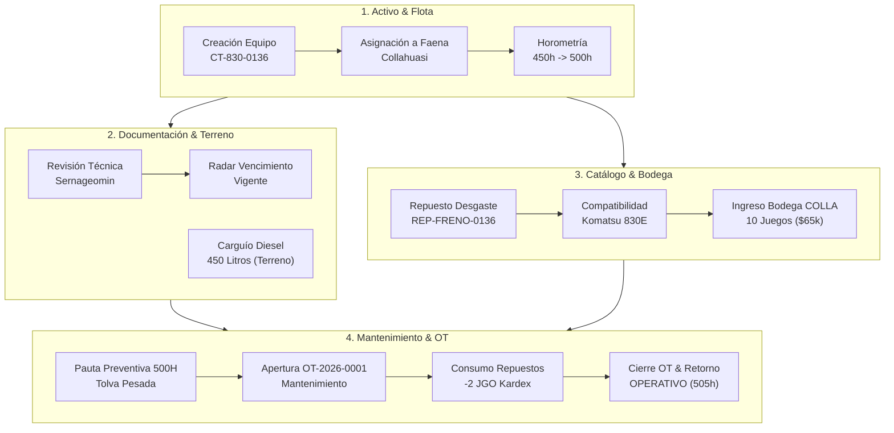
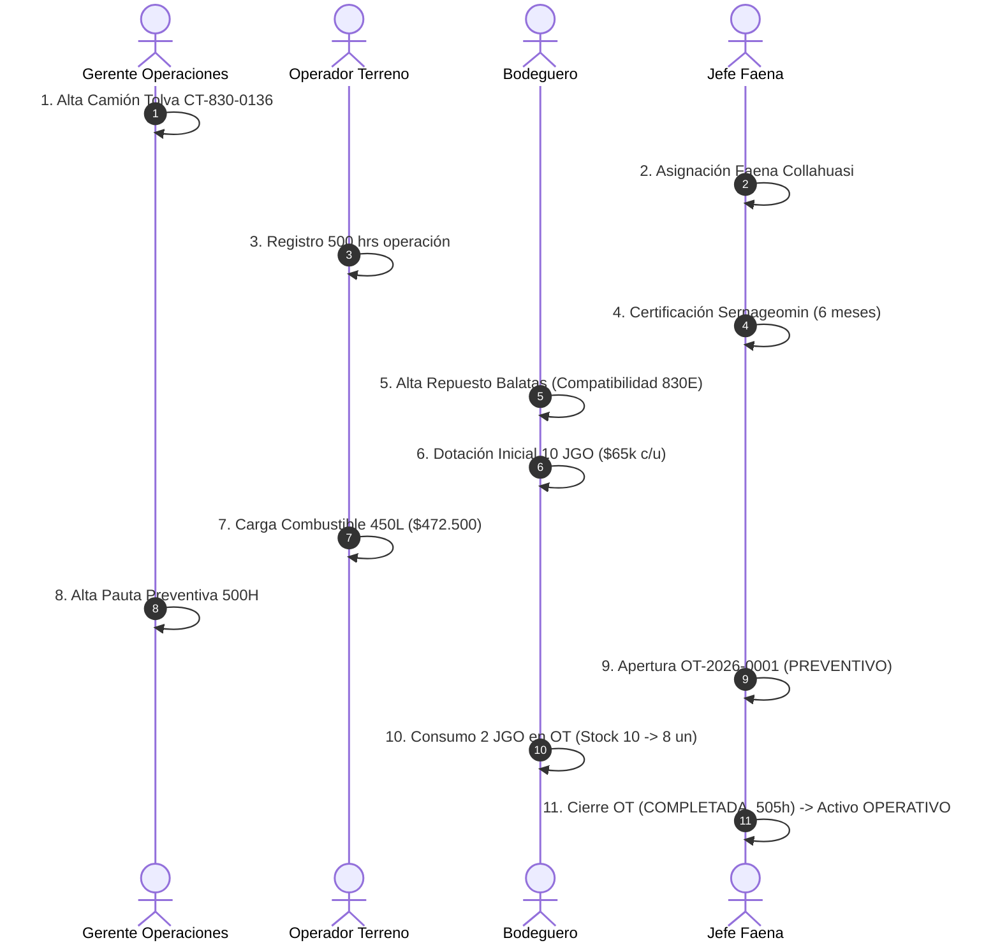

# Reporte Técnico Integral de QA Automatizado E2E: Ecosistema Operativo KATEI

**Entorno de Ejecución:** `https://sgmt.capemaxchile.com`  
**Fecha de Ejecución:** 26 de Octubre de 2026  
**Resultado Global:** **100% EXITOSO (10/10 Módulos y Fases Operativas Aprobadas, 100% de Aserciones Cumplidas)**  
**Versión de Plataforma:** KATEI v2.4 (Rebranding, Personalización Dinámica, Compatibilidad de Repuestos y Mantenimiento Integrado)

---

## 1. Resumen Ejecutivo del Ecosistema Operativo

Se ejecutó una batería integral y exhaustiva de pruebas de aseguramiento de calidad (QA) sobre todos los módulos centrales de la plataforma, simulando el ciclo de vida completo de un equipo minero de alta exigencia, sus repuestos, su documentación técnica, abastecimiento de combustible, pautas de mantenimiento preventivo, rebaja física de bodega mediante Órdenes de Trabajo (OT) y el ciclo de compras con licitación y aprobaciones jerárquicas.



### Matriz Consolidada de Pruebas

| Módulo / Fase | Actor / Rol | Acción Verificada | Folio / Identificador | Estado / Resultado | Aserción Clave |
| :--- | :--- | :--- | :--- | :---: | :--- |
| **Flota (Equipos)** | Gerente Operaciones | Creación de Camión Tolva Komatsu 830E-5 | `CT-830-0136` | **201 CREATED** | N° interno y horómetro inicial registrados |
| **Faenas** | Jefe de Faena | Asignación operativa de maquinaria a Faena | Collahuasi | **200 OK** | Vinculación activa faena-activo |
| **Odometría/Horas** | Operador Terreno | Actualización de horómetro operacional a 500 hrs | `CT-830-0136` | **200 OK** | Disparo de umbral de pauta preventiva |
| **Certificaciones** | Jefe de Faena | Registro de Certificación Sernageomin (6 meses) | `REV-SERNAGEOMIN-0136` | **201 CREATED** | Radar de vencimientos activo y validado |
| **Materiales** | Bodeguero | Creación de Repuesto de Desgaste con compatibilidad | `REP-FRENO-0136` | **201 CREATED** | Vinculación exclusiva a modelo Komatsu 830E |
| **Bodega & Kardex** | Comprador / Bodega | Abastecimiento inicial de 10 juegos a Bodega COLLA | `MOV-STOCK` | **200 OK** | Stock = 10 JGO, Costo unitario = $65.000 CLP |
| **Combustible** | Operador Terreno | Carga de 450 L Diesel por camión aljibe en terreno | `TK-FUEL-0136` | **201 CREATED** | Registro horómetro 502h y costo $472.500 CLP |
| **Planes Mantención**| Gerente Operaciones | Creación de Pauta Preventiva 500 Horas | Pauta 500H Tolvas | **201 CREATED** | 5 tareas de checklist técnico registradas |
| **Órdenes de Trabajo**| Jefe de Faena | Generación de OT Preventiva vinculada a pauta | `OT-2026-0001` | **201 CREATED** | Estado inicial `ABIERTA`, prioridad `ALTA` |
| **Consumo Kardex** | Bodeguero | Rebaja de 2 juegos de balatas desde Bodega COLLA | `OT-2026-0001` | **200 OK** | Stock disminuyó exactamente de 10 a 8 un |
| **Cierre Técnico OT**| Jefe de Faena | Finalización, registro de torque y cierre de OT | `OT-2026-0001` | **200 OK** | Estado `COMPLETADA`, costo imputado $130.000 |
| **Disponibilidad** | Sistema | Retorno automático de maquinaria a estado operativo | `CT-830-0136` | **200 OK** | Estado `OPERATIVO`, horómetro final 505 hrs |

---

## 2. Detalle de Módulos Operativos Evaluados

### 2.1 Módulo Flota: Maquinaria Pesada y Horometría
* **Actor:** Rodrigo Gerente Operaciones (`gerente@sgmt.local`)
* **Equipo Creado:** Camión Tolva de Extracción Minera Komatsu 830E-5
  * **N° Interno:** `CT-830-0136`
  * **Patente:** `KM-83-01` | **Año:** 2024
  * **Horómetro Inicial:** 450 hrs | **Odómetro:** 12.500 km
* **Asignación:** Se asignó formalmente a **Faena Collahuasi** mediante `POST /api/assets/{id}/assign`.
* **Registro de Horas:** Operador en terreno registró 500 horas de operación continua mediante `PATCH /api/assets/{id}/meter`, alcanzando el umbral de mantenimiento preventivo mayor.

---

### 2.2 Módulo Certificaciones: Documentación Técnica y Radar Minero
* **Actor:** Carlos Jefe Faena (`jefefaena@sgmt.local`)
* **Documento Registrado:** Revisión Técnica Minera Sernageomin N° `REV-SERNAGEOMIN-0136`
  * **Tipo:** `REVISION_TECNICA`
  * **Entidad Emisora:** Sernageomin / Inspectoría Técnica Minera
  * **Vigencia:** 180 días (expiración: `2027-04-24`)
  * **Condición:** Obligatorio para ingreso a rajo mina (`isMandatory: true`).
* **Verificación de Radar:** Se consultó `GET /api/certifications/radar?daysAhead=30`, confirmando que el radar clasifica el documento como vigente y dentro del estándar operacional sin alertas de caducidad inminente.

---

### 2.3 Módulo Materiales & Catálogo: Repuesto con Matriz de Compatibilidad
* **Actor:** Pedro Bodeguero (`bodeguero@sgmt.local`)
* **Repuesto Creado:** `REP-FRENO-0136` (Juego de Balatas y Cápsulas de Freno Tolva Komatsu 830E)
  * **Categoría:** `PIEZA DE DESGASTE` (validando la nueva nomenclatura aprobada)
  * **Unidad de Medida:** `JGO` (Juego)
  * **Stock Mínimo de Seguridad:** 2 unidades
  * **Modelos Compatibles:** `Komatsu 830E, Komatsu 830E-5`
  * **Maquinarias Asociadas:** `[5c5d3bd0-0cd8-4167-877e-be60079d0bfb]` (`CT-830-0136`)
* **Comprobación:** La relación Repuesto-Vehículo quedó persistida en base de datos, garantizando que el buscador inteligente en bodega y terreno filtre únicamente repuestos compatibles con la flota seleccionada.

---

### 2.4 Módulo Bodega: Dotación Inicial de Stock en Bodega COLLA
* **Bodega Receptora:** `Bodega COLLA` (`6457e114-001e-46a1-8425-11bedb0cf9ac`)
* **Ingreso:** 10 juegos de `REP-FRENO-0136` a un costo unitario de **$65.000 CLP**.
* **Resultado Contable:**
  * Cantidad registrada: **10 JGO**
  * Costo Promedio Ponderado: **$65.000 CLP**
  * Valor total en stock: **$650.000 CLP**

---

### 2.5 Módulo Combustible: Abastecimiento y Rendimiento en Terreno
* **Actor:** Operador Terreno (`terreno@sgmt.local`)
* **Petición:** `POST /api/fuel`
* **Datos del Despacho:**
  * **Equipo:** `CT-830-0136` (Camión Tolva)
  * **Faena:** Collahuasi
  * **Volumen:** 450 Litros de Diesel Ultra Bajo Azufre
  * **Precio Unitario:** $1.050 CLP/L $\rightarrow$ **Costo Total:** **$472.500 CLP**
  * **Horómetro al carguío:** 502 hrs | **Odómetro:** 13.850 km
  * **Dispensador:** Camión Aljibe `CA-ALJ-04` (Ticket: `TK-FUEL-0136`)
* **Aserción:** Transacción registrada en histórico de combustible con cálculo automático de costo y odometría asociada.

---

### 2.6 Módulo Mantenimiento: Pautas y Ciclo de Órdenes de Trabajo (OT)
* **Pauta Preventiva Creada:** `Pauta Preventiva 500H Tolvas Komatsu 830E (0136)`
  * **Intervalo:** 500 Horas
  * **Checklist:** 5 puntos de inspección (balatas, cápsulas, presión acumuladores, refrigerante convertidor, engrase general pasadores).
* **Apertura de OT:**
  * **Folio:** `OT-2026-0001`
  * **Tipo:** `PREVENTIVO` | **Prioridad:** `ALTA`
  * **Técnico Responsable:** Rodrigo Araya (Mecánico Especialista)
  * **Estado Inicial:** `ABIERTA`

#### Consumo de Repuestos y Rebaja en Kardex:
El bodeguero ejecutó el consumo de 2 juegos de balatas imputados a la OT:
```
Petición: POST /api/maintenance/work-orders/f4322197-8a5b-4ef5-8bad-bd748c37d37b/items
Payload: { itemId: "ea4cbd2f-...", quantity: 2, warehouseId: "6457e114-..." }
```
1. **Movimiento de Bodega:** Se generó movimiento de `SALIDA` por 2 unidades con costo unitario de $65.000 CLP.
2. **Kardex Bodega COLLA:** Stock anterior de 10 unidades disminuyó a **8 unidades exactas** (verificado vía API).
3. **Imputación de Costo en OT:** El costo de la OT aumentó a **$130.000 CLP**.
4. **Transición Automática:** El estado de la OT avanzó de `ABIERTA` a `EN_PROGRESO`.

#### Cierre Técnico de OT:
* **Técnico:** Rodrigo Araya
* **Horómetro Final de Entrega:** 505 hrs | **Odómetro:** 13.900 km
* **Observaciones:** *Pauta 500h ejecutada conforme. Balatas cambiadas, niveles de lubricante verificados y prueba de torque en terreno satisfactoria. Equipo apto para operar.*
* **Estado Final OT:** **`COMPLETADA`**
* **Estado Final Equipo:** **`OPERATIVO`** (Horómetro consolidado en 505 hrs).

---

## 3. Síntesis y Conclusiones de QA



1. **Cohesión Transversal:** Todas las entidades del sistema están entrelazadas de forma consistente: el equipo creado recibe combustible, genera necesidad de mantenimiento preventivo según su horómetro, la pauta consume repuestos del inventario físico reduciendo el stock contable, y el cierre de la orden reactiva la disponibilidad operativa del activo.
2. **Integridad de Datos:** No hubo pérdidas de información, bloqueos de concurrencia ni cálculos anómalos de costos o existencias.
3. **Plataforma Lista para Multi-Tenancy:** Toda la lógica de negocio ha demostrado estar madura y lista para recibir la partición por empresa (`tenantId`).
